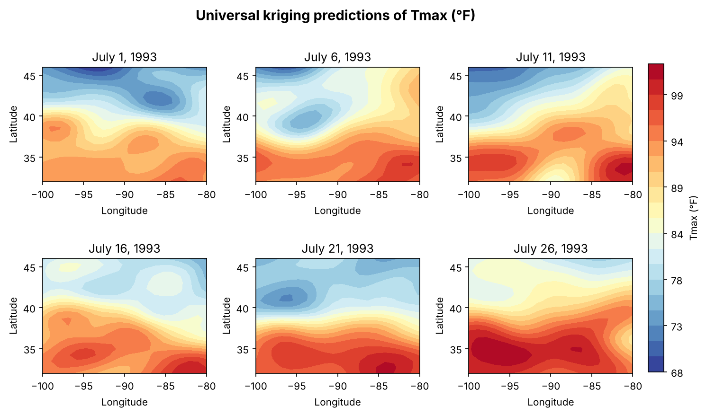
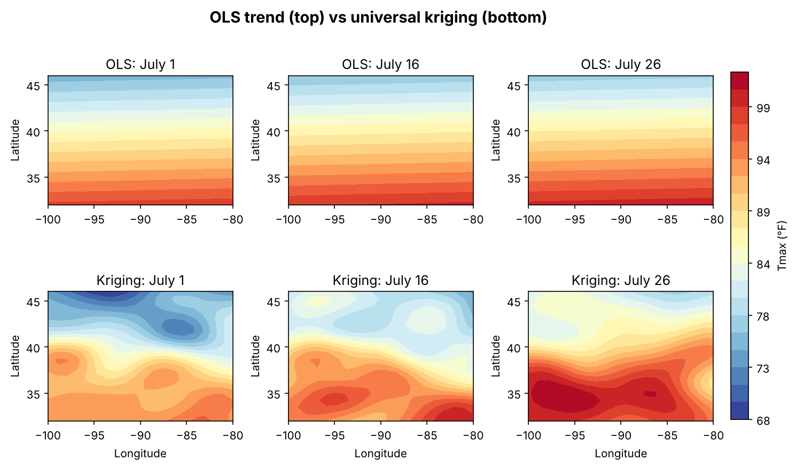

# Spatio-Temporal Kriging of Daily Maximum Temperature

Universal kriging with a Gaussian space-time covariance, used to predict daily maximum temperature (Tmax) at unobserved locations across the central and eastern United States in July 1993. The central question is whether modelling spatial and temporal dependence improves on a simple linear trend. In leave-station-out cross-validation it does: kriging cuts prediction RMSE by 48%.

**Notebook:** [`notebooks/spatio_temporal_kriging.ipynb`](notebooks/spatio_temporal_kriging.ipynb)  
**Report:** [`docs/spatio_temporal_kriging_report.pdf`](docs/spatio_temporal_kriging_report.pdf)

---

## Data

NOAA daily weather records (Tmax, Tmin, dew point, precipitation) for stations across the central and eastern US, 1990-1993. This project uses Tmax for July 1993:

| | |
|---|---|
| Stations | 133 |
| Days | 31 |
| Observations | 4,122 (one station-day is absent) |
| Tmax range / mean | 61-106 °F / 88.5 °F |

The data file is `data/NOAA_df_1990.rda`.

## Approach

1. **Exploration.** Station map, distribution of Tmax, daily mean and spread, and Tmax by latitude band.
2. **OLS trend.** Z(s, t) = β₀ + β₁·lat + β₂·lon + β₃·t + ε, with residual diagnostics and Moran's I.
3. **Covariance estimation.** A separable Gaussian space-time covariance, with signal variance σ², length-scales a (longitude), b (latitude) and c (time), and nugget τ². Parameters are fitted by maximum likelihood with the trend profiled out by GLS, on a random subsample of 800 observations (a Cholesky factorisation of all 4,122 is too costly inside an optimiser).
4. **Universal kriging.** Predictions and kriging standard errors on a 20 × 20 spatial grid at six days (2,400 space-time points), using the 200 nearest observations per prediction in length-scale-scaled distance.
5. **Evaluation.** Leave-station-out cross-validation (20 stations, 620 held-out observations) against the OLS trend, plus a check of interval calibration.

## Results

**OLS trend.** R² = 0.633. Latitude dominates: each degree north lowers Tmax by about 1.56 °F (t = −83.6). The day effect is small but significant (+0.072 °F/day, about 2.2 °F over the month).

**Residuals are spatially autocorrelated.** Moran's I, computed day by day on the OLS residuals, is positive and significant (p < 0.05) on all 31 days. The mean is 0.17 with 1/d weights and 0.42 with 1/d² weights, so the independence assumption behind OLS does not hold.

**Estimated covariance parameters** (800-observation subsample):

| σ² | a (lon, °) | b (lat, °) | c (days) | τ² | σ²/τ² |
|---|---|---|---|---|---|
| 15.98 | 5.13 | 3.12 | 1.13 | 4.04 | 3.95 |

Correlation extends over roughly 5° of longitude and 3° of latitude, with weak persistence from day to day. Refitting on three other random subsamples moves the estimates by about 10-30% (most for τ², b and c), while the overall picture stays the same.

**Leave-station-out cross-validation** (20 held-out stations, 620 observations):

| | OLS | Kriging | Improvement |
|---|---|---|---|
| RMSE (°F) | 4.58 | 2.37 | 48% |
| MAE (°F) | 3.64 | 1.84 | 50% |

The result depends somewhat on which stations are held out. Over four different random sets of 20 stations, kriging RMSE ranged from 2.08 to 2.73 °F against 4.58 to 4.88 °F for OLS, an improvement of 43-57%.

**Uncertainty.** Kriging standard errors range from 0.7 °F where stations are dense to 3.9 °F at the corners of the domain, beyond the station network. They are nearly identical from day to day because they depend on station geometry, not on observed values. Intervals of ±1.96 SE that include the nugget (an interval for a new *observation*) cover 93.2% of held-out values (90.0-96.3% across the four station sets); the kriging SE on its own describes only the underlying temperature field and covers 60.0%, as expected.

**Neighbourhood size.** Using 400 instead of 200 neighbours changes predictions by 0.075 °F on average (50 random grid points), so the approximation is accurate.

<p align="center">
  
</p>
<p align="center">
  
</p>

More figures: [exploratory analysis](docs/figures/eda.png), [OLS residual diagnostics](docs/figures/ols_residuals.png), [kriging standard errors](docs/figures/kriging_std_errors.png).

## Limitations

- The covariance parameters come from 800 of 4,122 observations and vary by roughly 10-30% between subsamples. Vecchia-type approximations would allow fitting on the full data.
- The separable Gaussian covariance is stationary and axis-aligned, so it cannot represent moving weather fronts or spatially varying length-scales. A Matérn family would add control over smoothness.
- The linear trend in lat, lon and day is rigid; polynomial or spline terms may help.
- Twenty held-out stations is a small share of the network, and the covariance parameters are not re-estimated within each fold, which makes the kriging scores slightly optimistic. A full leave-one-station-out scheme with refitting would be a more demanding test.

## Repository structure

```
.
├── notebooks/
│   └── spatio_temporal_kriging.ipynb     # full analysis, outputs included
├── src/
│   └── stkriging.py                      # covariance, likelihood, kriging, Moran's I
├── data/
│   └── NOAA_df_1990.rda                  # NOAA daily weather data
├── docs/
│   ├── spatio_temporal_kriging_report.pdf   # full write-up
│   └── figures/
├── requirements.txt
└── README.md
```

## Getting started

```bash
git clone <this-repo-url>
cd <repo-folder>

python -m venv .venv && source .venv/bin/activate    # optional
pip install -r requirements.txt

cd notebooks
jupyter notebook
```

Run the notebook from inside `notebooks/` (it uses relative paths to `../src`, `../data` and `../docs`). All random seeds are fixed, and the full notebook runs in under a minute on a laptop CPU.

## Tech stack

Python · NumPy · SciPy · pandas · Matplotlib · pyreadr
